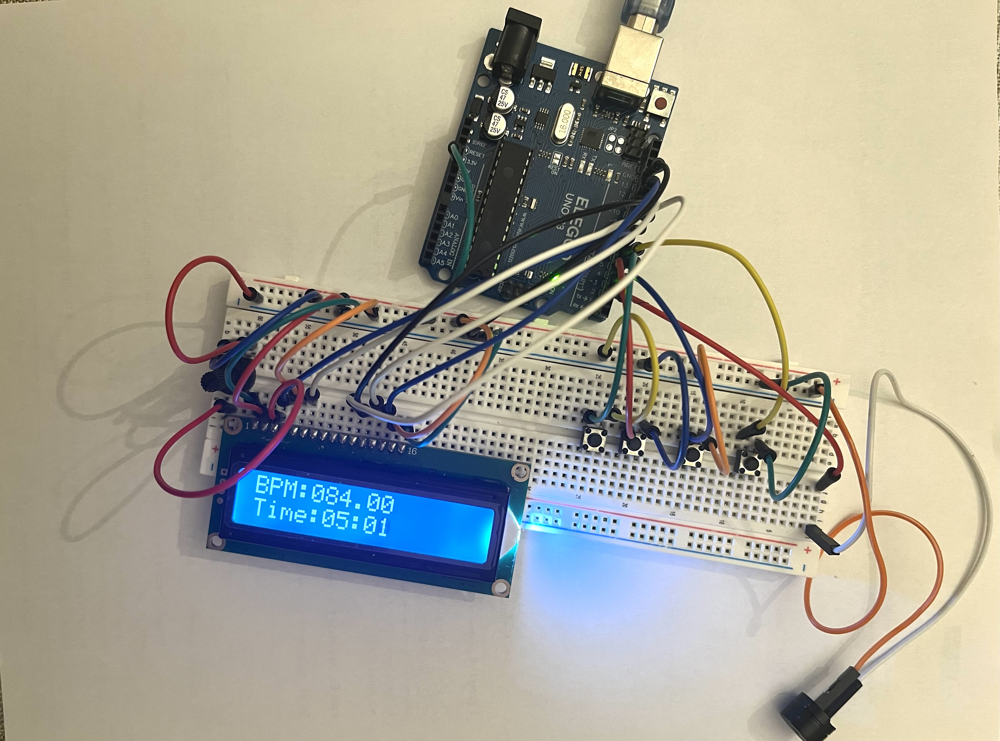
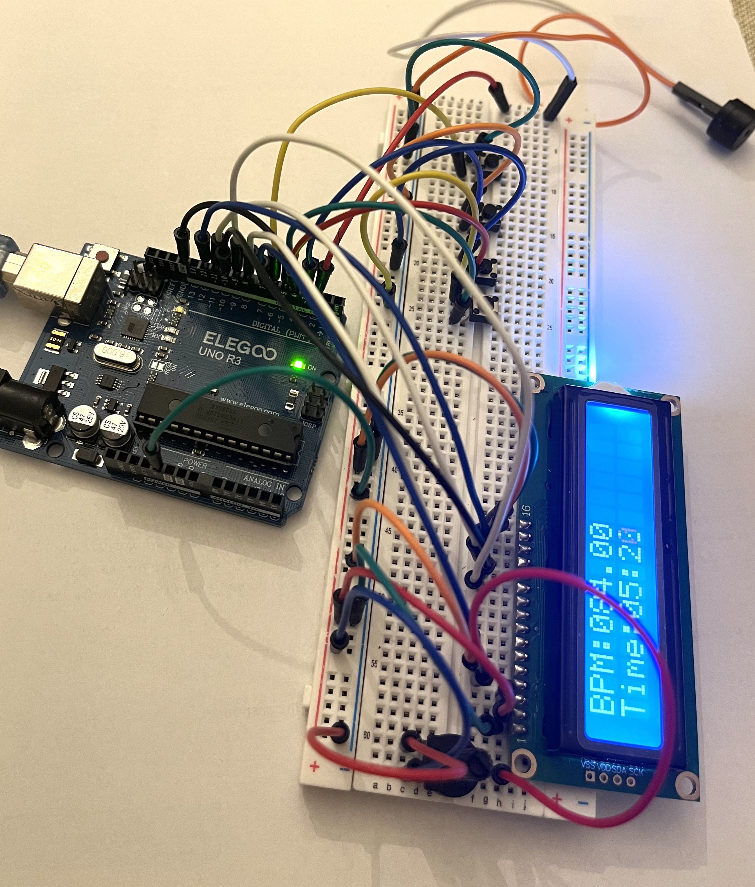
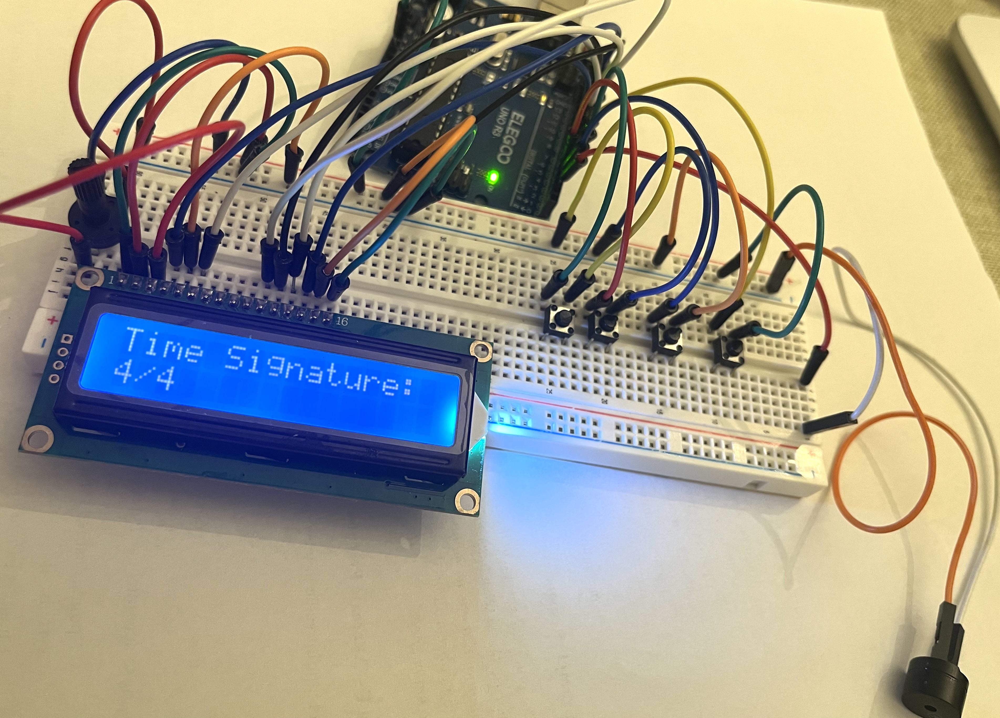

# Arduino Metronome

A digital metronome built with Arduino that provides adjustable tempo, selectable time signatures, audible beat accents, and an LCD-based user interface.

## Why I Built This

I've played in orchestra for 7 years and have a deep interest in both music and electrical engineering. I wanted to build something that combined the two, so I made a metronome I could customize, understand completely at the hardware and software level, and improve over time. This project was my introduction to embedded systems: writing timing-critical code, designing a menu-driven interface around four buttons, and debugging a real circuit.

I learned how each component (buttons, LCD, buzzer) works from documentation and examples, then designed the overall system myself, including the menu logic, state handling, and beat timing.
## Features
- Adjustable tempo using physical buttons
- Serial tempo input through the Arduino Serial Monitor
- Selectable time signatures through an LCD menu
- Audible beat generation using a piezo buzzer
- Beat accents based on the selected time signature
- Start/stop functionality
- Four-button control system
- Potentiometer-controlled LCD display
## Hardware
| Component | Purpose |
|---|---|
| Arduino | Main microcontroller |
| LCD display | Displays tempo, time signature, and menu information |
| Piezo buzzer | Produces the audible metronome beats |
| Potentiometer | Adjusts the LCD display |
| 4 push buttons | User input and menu navigation |
| Breadboard | Circuit prototyping |
| Jumper wires | Electrical connections |

## User Controls
Control	Function
| Control | Function |
|---|---|
| Left button | Decreases the selected value |
| Right button | Increases the selected value |
| Menu button | Goes to the menu screen |
| Start/Stop button | Starts or stops the metronome / selects the menu option |
| Potentiometer | Adjusts the LCD display |

The tempo can also be entered directly through the Arduino Serial Monitor.

## How It Works

Tempo — The Arduino calculates the interval between beats from the selected BPM and triggers the buzzer at that interval. Tempo is adjustable via buttons or Serial Monitor input.

Time signatures — A menu system lets the user select a time signature, which determines how many beats occur per measure and where the primary accent falls. For example, in 4/4 time, beat one is accented so the musician can track the start of each measure:

ONE - two - three - four

### User Interface

The LCD shows the current settings and menu options. The left and right buttons change values, and the Start/Stop button controls playback and confirms menu selections.

## Software

The project is programmed using the Arduino programming environment and C/C++.

The software handles:

- Beat timing and tempo calculation
- Beat counting and accent generation
- Time signature selection
- LCD output
- Button input and menu navigation
- Serial input
  
# Project Structure
Arduino-Metronome/
├── Arduino-Metronome.ino
└── README.md
## Current Status

Core functionality is complete and working on a breadboard prototype: adjustable tempo, time signature selection, LCD interface, menu navigation, audible beats with accents, and full button control.

The project is currently being developed as a hardware prototype using a breadboard and jumper wires.

# Future Improvements

Potential future improvements include:

- Add additional time signatures
- Add tap-tempo functionality
- Add additional rhythm patterns
- Add visual beat indicators
- Improve the menu interface
# What I Learned

A problem I ran into and how I solved it: I wanted the tempo to increase by exactly one BPM on a quick tap, but increase faster when the button was held down. At first, a single tap changed the value many times. The code loop runs thousands of times per second, so one short press was registered on every pass while the button was down. I solved this with a variable that records whether the button was already pressed on the previous pass, so the value changes only once, at the moment of a press. Holding the button longer then increases the value more quickly.

A design decision I made: I chose to use the start/pause to act as the "select" button for the menu. This is because I only wanted to have four buttons to keep the controls very simple. In order to do this, I needed to keep track of the screen the user was on in order to change the purpose of the button. 

What I would do differently: I repeated the same “pressed once” flag logic separately for each of the four buttons, which added many extra variables. Next time I would write one reusable function so I would only require need to create one variable and change it after each button press. 

Built with Arduino as an electronics and embedded-systems project.
